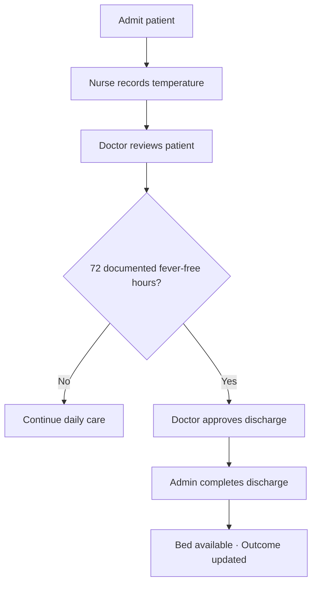

# VItalSync — quarantine facility dashboard

A React prototype for coordinating a 74-bed quarantine and treatment facility. Track patient care, temperature checks, doctor reviews, and discharges using synthetic demo records.

## Getting started

You need Node.js 20.19+ (or 22.12+) and npm.

```bash
git clone https://github.com/yashforce1/VitalSync.git
cd VitalSync
npm install
npm run dev
```

Keep the development server running while using the app. Press Ctrl+C to stop it.

```bash
npm test           # Check workflow rules
npm run build     # Create the production build in dist/
npm run preview   # Preview the production build
```

## Patient care workflow

VItalSync shows who needs a temperature check, who is ready for a doctor review, and who can move toward discharge.



A recorded death also closes the case, releases its bed, and updates outcome reporting.

## Try the demo

1. **Overview** starts with 74 active patients, 56 temperature checks, 30 doctor reviews, 6 discharge-eligible patients, and 2 approved discharges.
2. In **Daily rounds → Temperature due**, select **Record temp**, enter a value such as `36.8`, and save. The patient moves to the doctor review queue.
3. Complete a **Doctor review** by saving a review note after the temperature check.
4. In **Discharges**, approve an eligible patient or complete an approved discharge to release a bed.
5. Select **Admit patient** to fill an available bed. Open a patient’s name to view temperature history and doctor notes.
6. Use **Insights & reports** for outcome rates and **Export CSV** for patient summaries.
7. Use **Facility settings → Reset demo** to restore the starting data on the current date.

## Features

| Screen | Purpose |
| --- | --- |
| Overview | Occupancy, care progress, discharge eligibility, and recent activity |
| Patients | Search, ward filters, pagination, and active or closed records |
| Daily rounds | Ordered temperature and doctor review queues |
| Patient record | Temperature chart, reading history, review notes, and case outcome |
| Discharges | Eligibility checks, doctor approval, and admin completion |
| Insights & reports | Recovery/mortality rates, benchmarks, alerts, and CSV export |
| Getting started | In-app workflow guide and development roadmap |
| Facility settings | Fever threshold, capacity, timezone, and demo reset |

Counts come from the patient records and update after each action. Changes persist in browser localStorage. The interface supports desktop and mobile screens, keyboard-operated dialogs, and form validation.

## Key rules

- **Capacity:** Up to 74 active patients, each with a unique bed. Closed cases retain their history and release their beds.
- **Saved care date:** The demo keeps the care date shown in the header. Changing the computer date or reopening tomorrow preserves records and care counts. Actions use that same date; **Reset demo** starts a new session on the current date. Older workspaces infer their care date from the latest record.
- **Daily care:** One routine temperature check and one doctor review per patient per facility day. Temperature comes first. The facility timezone is **Asia/Kolkata (IST)**.
- **Fever threshold:** **38.0°C** by default, configurable in settings. A reading at or above the threshold counts as fever.
- **Discharge eligibility:** At least **72 elapsed hours**, with a below-threshold reading on every consecutive facility date through the care date. Fever or a missing daily reading blocks eligibility; three readings across 48 hours are insufficient.
- **Discharge approval:** Requires the care date’s doctor review, doctor approval, and admin completion. A new temperature reading or threshold change clears prior approval.
- **Outcomes:** Recovery and mortality are calculated from completed cases only. Mortality above **15%** triggers an alert; recovery is compared with an **85%** benchmark. With no completed cases, rates are unavailable.

The demo includes **116 recovered** and **14 deceased** cases: approximately **89.2% recovery** and **10.8% mortality**. Historical cases contain outcome metadata without temperature or review logs. The app stores review notes without recommending treatment.

## How it works

**React** renders the interface, **Vite** handles development and builds, **CSS** provides styling, and **Lucide** supplies icons. Temperature charts use SVG.

When an action is saved, `src/domain.js` validates the workflow, updates the patient data, and adds an activity entry. React refreshes the screens, and the data is saved to localStorage.

```text
src/main.jsx          React entry point
src/App.jsx           Screens, forms, dialogs, CSV export, and persistence
src/styles.css        Layout and styling
src/domain.js         Workflow rules, calculations, and demo data
src/domain.test.js    Workflow and reporting tests
vite.config.js       Vite + React configuration
public/favicon.svg   App icon
```

## Prototype scope and next steps

This frontend demo uses synthetic data and browser storage. It has no backend, authentication, shared database, or clinical audit trail; all staff roles are demonstrated in one interface.

To develop it into a shared facility product:

1. Confirm facility policies for fever, missing readings, discharge, and record corrections.
2. Add an API, shared database, staff accounts, and role-based permissions.
3. Enforce unique bed assignments and daily records, with concurrency controls and audit history.
4. Validate workflows with facility staff and add backups, security controls, and operational monitoring.

## Verification

Run `npm test` to check care-date persistence, eligibility, ordered handoffs, duplicate prevention, admissions, discharge approvals, and outcome calculations. Use `npm run build` to verify the production build.

Browser checks cover the patient workflow, desktop/mobile layouts, and preserving care counts across date changes and reloads. Google Fonts has local sans-serif fallbacks.
